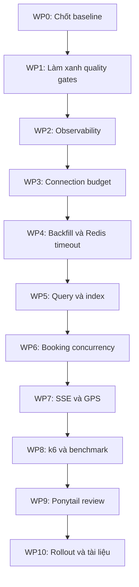

# Lambe Backend — Kế hoạch nâng cấp và khắc phục sau Audit

**Ngày lập:** 2026-11-21  
**Nguồn:** `backend-performance-prisma-postgres-ponytail-audit-2026-11-21.md`  
**Trạng thái:** Đang triển khai; tiến độ và bằng chứng trong `backend-upgrade-implementation-log-2026-11-21.md`  
**Phạm vi:** Backend NestJS, Prisma v6, PostgreSQL, Redis, SSE/GPS, observability, test và load test

## 1. Mục tiêu

- Đưa các quality gate hiện tại về trạng thái xanh và có thể lặp lại trên CI.
- Đo được latency, error, event-loop, Prisma/PostgreSQL, Redis và realtime trước khi tối ưu.
- Giảm nguy cơ pool exhaustion, lock contention, Redis stall và request chạy quá lâu.
- Tối ưu các API có bằng chứng bottleneck, không tối ưu theo phỏng đoán.
- Giữ nguyên API contract, nghiệp vụ, bảo mật và tính nhất quán của booking/wallet/commission.
- Xây dựng bộ Grafana k6 cho smoke, load, stress, spike và soak test.
- Loại bỏ complexity không tạo giá trị sau khi đã có bằng chứng và test bảo vệ.

## 2. Nguyên tắc bắt buộc

- PostgreSQL tiếp tục là source of truth.
- Không nâng Prisma, đổi driver adapter hoặc thêm PgBouncer nếu chưa có bằng chứng kỹ thuật.
- Không tự ý thay đổi database schema, API contract hoặc nghiệp vụ.
- Không chạy migration/load test trên production.
- Không cache balance, commission, access control hoặc booking state cần strong consistency.
- Không gỡ advisory lock, row lock, idempotency key hoặc unique constraint khi chưa có concurrency test tương ứng.
- Mỗi thay đổi phải có baseline trước, kết quả sau, test và rollback plan.
- Mỗi module được triển khai bằng PR độc lập; không gom refactor diện rộng với thay đổi hiệu năng.
- Không tuyên bố đạt p95/p99 nếu chưa benchmark trong môi trường được kiểm soát.

## 3. Quality gates chung

Mỗi work package chỉ được đánh dấu hoàn thành khi đáp ứng:

- [ ] `npx prisma validate` thành công.
- [ ] Production TypeScript typecheck thành công.
- [ ] Test TypeScript typecheck thành công.
- [ ] Lint/Prettier thành công.
- [ ] Unit test thành công.
- [ ] Integration test liên quan thành công.
- [ ] Không phá API contract.
- [ ] Không giảm bảo mật hoặc data consistency.
- [ ] Có benchmark trước/sau nếu thay đổi nhằm tăng hiệu năng.
- [ ] Có ghi nhận CPU, RAM, database connections và Redis latency khi load test.
- [ ] Diff đã qua review correctness, security, performance và simplification.

Mục tiêu ban đầu cần được kiểm chứng:

| Chỉ số | Mục tiêu |
|---|---:|
| API p95 | ≤ 200 ms |
| API p99 | ≤ 500 ms |
| Error rate trong load test | < 1% |
| N+1 nghiêm trọng | 0 |
| Transaction regression | 0 |
| Memory leak qua soak test | 0 |
| API contract regression | 0 |

## 4. Thứ tự triển khai tổng thể

Không bắt đầu WP5/WP6 khi WP2 chưa cung cấp đủ số liệu truy vấn, transaction và lock.

## 5. Work packages

**Cập nhật môi trường 23/11/2026:** PostgreSQL runtime ở Neon (API dùng pooled URL, migration dùng direct URL); Redis runtime ở Upstash qua TLS. Người dùng xác nhận có thể kiểm thử trên database phát triển hiện tại vì không có dữ liệu quan trọng. Bộ chạy development phải bật chế độ test rõ ràng và tắt tích hợp Firebase, thanh toán, email, Cloudinary, Gemini. WP0 về môi trường cô lập và baseline dữ liệu đại diện vẫn chưa đạt; các bài benchmark tạo dữ liệu yêu cầu target sạch hoặc cách dọn fixture riêng. Xem `development-cloud-test-runbook-2026-11-23.md`; cấu hình test tách riêng vẫn nằm trong `cloud-test-environment-2026-11-23.md`.

**Cập nhật bằng chứng 24/11/2026:** Docker test stack đã hoạt động; synthetic baseline cô lập chạy pass sau khi sửa Feed fixture, và các integration suites chính đã chạy tại máy local. Redis half-open test tìm thấy command timeout sau khi gửi không được node-redis bảo vệ; deadline phía ứng dụng và shutdown được sửa, 4/4 test Redis thật pass. WP0 vẫn thiếu staging dataset đại diện và reset/repeat protocol; WP1 còn fail coverage; WP2–WP10 chưa đủ tiêu chí hoàn thành. Chi tiết và số đo ở `backend-upgrade-implementation-log-2026-11-21.md`.

**Cập nhật tiếp 24/11/2026:** Redis command-client paths cho cache, Feed index, khóa, vị trí provider/member và tracking đã được ràng buộc deadline; 8/8 fault tests bằng Redis thật pass. Subscriber acknowledgement, Upstash benchmark, coverage threshold và các checkpoint toàn chương trình vẫn mở.

**Cập nhật cuối phiên 24/11/2026:** Subscriber acknowledgement cũng có deadline và recovery test; Redis fault suite đạt 9/9. Avatar backfill có guard tránh ghi đè khi hai lượt chạy đụng cùng hồ sơ. Ba synthetic baseline liên tiếp sau reset đạt, nhưng một lượt trước đó đo Feed 9→10 SQL nên nguồn nhiễu cần tiếp tục xác định. WP0 local reset đã tự động hóa; coverage và staging đại diện vẫn chặn Checkpoint A.

**Cập nhật phép đo và tối ưu 24/11/2026:** HTTP runtime cũ gặp 503 tại Redis rate-limit path. Các GET danh mục/dịch vụ công khai được giới hạn cục bộ chặt hơn khi Redis lỗi, giữ fail-closed cho đặt lịch và thao tác ghi. Hai cặp truy vấn độc lập trên đường báo giá/lịch hẹn được chạy đồng thời; kết quả đọc-only PostgreSQL development và giới hạn ở `qa/booking-and-public-read-optimization-2026-11-24.md`. Image đang chạy chưa chứa các sửa đổi này; WP5/WP6/WP8 và mục tiêu p95 vẫn mở.

## WP0 — Chốt baseline và môi trường kiểm thử cô lập

**Ưu tiên:** P1  
**Mục đích:** Tạo mốc đo đáng tin cậy và không tác động dữ liệu thật.

### Công việc

- [x] Chốt commit/branch làm baseline và ghi lại working-tree state.
- [ ] Tách các thay đổi đang dở khỏi PR tối ưu hiệu năng.
- [x] Chuẩn bị PostgreSQL và Redis test cô lập bằng `docker-compose.test.yml` (staging cloud vẫn mở).
- [x] Tạo dataset synthetic cho individual providers, services, orders, chat và feed trong baseline local (organization và tải đại diện vẫn mở).
- [ ] Tạo test users riêng cho customer, worker, organization và admin.
- [ ] Cấu hình payment, push, SMS, email, Cloudinary và OSRM ở mock/sandbox mode.
- [ ] Xác nhận mọi load-test endpoint không chạm payment hoặc dữ liệu production.
- [x] Ghi lại cấu hình máy, Node version, database version và Redis version trong synthetic baseline artifacts trên Windows.
- [x] Chốt protocol local: warm-up 5, 100 mẫu cho mỗi Discovery mode, concurrency 4 và ba lượt pass sau reset (production-like staging vẫn mở).

### Tiêu chí hoàn thành

- [ ] Có environment URL và credentials chỉ dành cho test.
- [x] Có script reset test data local, kiểm tra tên/image/port/tmpfs của Compose trước khi dọn và chạy lại 68 migrations; CI dùng dịch vụ tạm riêng.
- [ ] Có baseline report có thể chạy lại từ cùng commit.
- [ ] Không dùng production secret hoặc production database.

## WP1 — Làm xanh quality gates và CI

**Ưu tiên:** P1  
**Phụ thuộc:** WP0

### Công việc

- [x] Sửa Prettier violations trong category DTOs (6 file theo lần kiểm tra 21/11).
- [x] Chạy health readiness test trong E2E local có thể mở socket; E2E 81/81 pass ngày 24/11.
- [x] Phân loại lỗi EACCES cũ là hạn chế socket trong phiên audit; local E2E pass.
- [x] Dùng `test:cov` hiện có và cho CI enforce threshold đã khai báo; coverage hiện chưa đạt, xem implementation log.
- [x] Không hạ coverage threshold chỉ để làm xanh CI.
- [x] Lập integration suite matrix theo module và timeout trong implementation log.
- [x] Bổ sung các suite quan trọng còn thiếu khỏi CI (chờ CI chạy xác nhận):
  - [x] Feed cache.
  - [x] Organization chat/feed/finance/reviews.
  - [x] Provider members/capabilities/verification/notifications.
  - [x] Redis recovery.
- [x] Chạy dependency audit trong môi trường có npm registry access ngày 23/11; 30 advisory tổng, 13 trong dependency tree khi `--omit=dev`.
- [x] Phân loại sơ bộ vulnerability theo runtime image và đường gọi mã; exploit validation/upgrade còn mở (`dependency-audit-triage-2026-11-24.md`).
- [ ] Chỉ nâng dependency nhỏ/an toàn trong PR riêng; major upgrade cần kế hoạch riêng.

### Tiêu chí hoàn thành

- [x] `npm run check` xanh với 896 unit test ngày 23/11. Readiness HTTP nằm trong bộ E2E.
- [ ] Coverage được CI thực thi và lưu artifact.
- [ ] Integration matrix có owner, trigger và timeout.
- [ ] Không còn test bị skip ngoài các test yêu cầu external service được ghi rõ.
- [x] Dependency audit có ngày, lockfile hash và quyết định xử lý trong `dependency-audit-triage-2026-11-24.md` (các dependency runtime chưa được nâng).

## WP2 — Observability production-grade

**Ưu tiên:** P1  
**Phụ thuộc:** WP1

### 2.1 HTTP và Node.js

- [x] Ghi nhận tổng request, lỗi 4xx/5xx, số request đang xử lý, thời gian và lưu lượng trung bình của process.
- [x] Trả số đếm theo bucket ở API admin để công cụ thu thập tính p50/p95/p99. Việc thu thập nhiều instance vẫn mở.
- [x] Thêm event-loop lag bằng API Node.js.
- [x] Ghi nhận RSS, heap, GC và CPU theo process.
- [x] Giới hạn số nhãn route và dùng route template của Express làm nhãn.
- [x] Gắn request ID vào log hoàn thành HTTP.
- [ ] Thiết lập redaction cho authorization, cookie, JWT, OTP, payment và PII.

### 2.2 Prisma và PostgreSQL

- [x] Thêm histogram lấy mẫu thời gian SQL từ query event của Prisma.
- [x] Chỉ lấy thời gian từ query event cho telemetry mới.
- [ ] Ghi nhận slow query count theo operation/model, không theo raw SQL label.
- [ ] Theo dõi active/idle connections và pool wait nếu runtime cho phép.
- [ ] Thu thập `pg_stat_activity`, `pg_stat_statements`, lock waits và deadlocks bằng read-only account.
- [ ] Theo dõi database cache hit ratio, transaction duration và rollback rate.
- [ ] Đặt cảnh báo pool saturation, lock wait và slow-query budget.

### 2.3 Redis

- [ ] Ghi nhận command latency theo nhóm command bounded.
- [ ] Ghi nhận timeout, reconnect và command error.
- [ ] Ghi nhận cache hit/miss theo cache domain.
- [ ] Theo dõi memory usage, evictions và connection count.
- [ ] Ghi nhận Pub/Sub reconnect và subscriber health.

### 2.4 SSE/GPS

- [x] Ghi nhận active SSE connections theo process.
- [x] Ghi nhận kết thúc kết nối, abort, resume và số frame Nest ghi ra.
- [ ] Ghi nhận GPS accepted, stale rejected, out-of-order rejected và update rate.
- [ ] Không dùng user/order/provider ID làm metric label.

### Tiêu chí hoàn thành

- [ ] Dashboard aggregate được nhiều backend instances.
- [ ] Process restart không làm mất lịch sử cần thiết.
- [ ] Có alert runbook cho database, Redis, event-loop và SSE.
- [ ] Security test xác nhận log/metric không chứa secret hoặc PII.
- [ ] Overhead observability được benchmark và nằm trong budget đã duyệt.

## WP3 — PostgreSQL connection budget và Prisma pool

**Ưu tiên:** P1  
**Phụ thuộc:** WP2

### Công việc

- [x] Xác minh PostgreSQL development runtime version trực tiếp: Neon 18.7 (production chưa có).
- [x] Xác minh Neon pooled endpoint cho API và direct endpoint cho migration trên cấu hình development.
- [x] Ghi nhận Neon `max_connections=901`, superuser reserved 4, reserved 0 ở thời điểm probe development; budget ứng dụng vẫn chưa xác định.
- [ ] Ghi nhận số backend replicas tối thiểu/tối đa.
- [ ] Xác minh Prisma v6 pool size thực tế trên mỗi instance.
- [ ] Ghi nhận peak active/idle connections và pool wait dưới load.
- [ ] Tính connection budget theo công thức:
  - [ ] `instances × pool size + operational connections < usable DB connections`.
- [ ] Đánh giá `connection_limit` và `pool_timeout` dựa trên load evidence.
- [ ] Kiểm tra behavior khi database chậm, connection timeout và pool exhausted.
- [ ] Chỉ đánh giá PgBouncer nếu Neon pooling hiện tại không đáp ứng topology thực tế.

### Tiêu chí hoàn thành

- [ ] Có tài liệu connection budget cho min/max replica.
- [ ] Có alert trước khi chạm giới hạn connection.
- [ ] Không tăng pool chỉ để che slow query hoặc long transaction.
- [ ] Có test pool exhaustion và graceful failure.

## WP4 — Khắc phục công việc unbounded và Redis stall

**Ưu tiên:** P1  
**Phụ thuộc:** WP2, WP3

### 4.1 Provider avatar backfill

- [x] Viết characterization tests cho pagination, resume và trường hợp hai lượt backfill cùng xử lý một hồ sơ (Cloudinary race thực tế vẫn mở).
- [x] Thêm cursor pagination và batch size có giới hạn (25/batch).
- [x] Giới hạn tổng số record mỗi admin invocation (mặc định 100, tối đa 500).
- [ ] Đảm bảo retry idempotent.
- [x] Không giữ database transaction trong lúc gọi Cloudinary.
- [x] Ghi lại scanned, updated, skipped và failed count cùng resume cursor.
- [x] Không trả toàn bộ failure payload không giới hạn trong response.
- [ ] Cân nhắc background job chỉ khi request-batch vẫn không đáp ứng nhu cầu vận hành.

### 4.2 Redis command deadline

- [x] Lập timeout/fallback matrix cho cache, rate limit, OTP, GPS, tracking và Pub/Sub (`redis-deadline-matrix-2026-11-23.md`).
- [ ] Hoàn tất deadline mọi request-critical path: GET/MGET, rate limit, SET và tracking HGET đã có cả native/ứng dụng; các Redis path khác còn mở.
- [ ] Generic cache tiếp tục fail-open khi an toàn.
- [ ] Rate limit/realtime correctness paths tiếp tục fail-closed.
- [x] Thêm log rate limit 30 giây theo operation để tránh log storm.
- [ ] Test Redis slow, half-open, reconnect và total outage.
- [ ] Xác nhận subscriber cleanup không mất listener khi reconnect.

### Tiêu chí hoàn thành

- [ ] Avatar backfill memory và thời gian xử lý bị giới hạn theo batch.
- [ ] Redis chậm không giữ request quá timeout budget.
- [ ] Fallback không làm sai booking, balance, authorization hoặc commission.
- [ ] Recovery test xanh sau khi Redis hoạt động trở lại.

## WP5 — Query, pagination và PostgreSQL index

**Ưu tiên:** P2  
**Phụ thuộc:** WP2, WP3, WP4

### 5.1 Admin provider list

- [ ] Bật query-count instrumentation trong integration test.
- [ ] Xác định số SQL thực tế cho `findMany` có relations và `groupBy`.
- [ ] Benchmark search rỗng, search theo tên, phone, service area và ID.
- [ ] Thu thập `EXPLAIN (ANALYZE, BUFFERS)` trên staging dataset.
- [ ] Xác minh current indexes qua `pg_indexes` và usage qua `pg_stat_user_indexes`.
- [ ] Đánh giá `pg_trgm`/GIN cho leading-wildcard search nếu query plan chứng minh cần thiết.
- [ ] Đánh giá composite/partial index cho filter + order phổ biến.
- [ ] Tính write/storage cost trước khi tạo index.
- [ ] Chỉ thêm migration sau khi được phê duyệt riêng.

### 5.2 Read-only list transactions

- [ ] Liệt kê 10 endpoint dùng `$transaction([findMany, count/groupBy])`.
- [ ] Xác định endpoint nào yêu cầu list/count cùng snapshot.
- [ ] Với endpoint không yêu cầu snapshot, benchmark `Promise.all` không transaction.
- [ ] Với endpoint cần snapshot, test isolation level tường minh.
- [ ] Kiểm tra pool usage và latency trước/sau.

### 5.3 Pagination

- [ ] Ghi nhận page depth thực tế ở admin APIs.
- [ ] Benchmark offset ở page nhỏ, trung bình và sâu.
- [ ] Chỉ chuyển sang keyset/cursor khi data volume và UX phù hợp.
- [ ] Nếu đổi pagination contract, tạo version/migration plan riêng; không thay ngầm.

### 5.4 Provider/member discovery

- [ ] Trace 50 Redis position lookups và tỷ trọng network time.
- [ ] Chỉ dùng batch/pipeline/Lua nếu có lợi ích đo được.
- [ ] Thêm query/command count regression tests.

### Tiêu chí hoàn thành

- [ ] Không còn query bottleneck đã được xác nhận mà chưa có decision record.
- [ ] Không thêm index trùng hoặc index không được dùng.
- [ ] Mọi index có before/after plan, write cost và rollback migration.
- [ ] API response contract giữ nguyên trừ khi có phê duyệt riêng.

## WP6 — Booking, wallet và commission concurrency

**Ưu tiên:** P1/P2  
**Phụ thuộc:** WP2, WP3, WP5

### Công việc bảo vệ trước refactor

- [ ] Viết test concurrent booking cùng customer request ID.
- [ ] Viết test hai customer tranh cùng provider/member/time slot.
- [ ] Viết test organization có nhiều member nhận booking đồng thời.
- [ ] Viết test cancel và accept chạy đồng thời.
- [ ] Viết test complete/cancel/dispute chạy cạnh tranh.
- [ ] Viết test commission deduction retry và duplicate delivery.
- [ ] Viết test wallet held/balance không lost update.
- [ ] Viết deadlock/retry tests cho lock order đã chọn.

### Tối ưu transaction

- [ ] Đo transaction duration, lock wait và number of statements.
- [ ] Tách validation/read-only work ra ngoài transaction chỉ khi có recheck dưới lock.
- [ ] Không đặt external network call trong transaction.
- [ ] Xác định `maxWait`/`timeout` phù hợp cho interactive transactions.
- [ ] Xác minh lock acquisition order giữa order, provider/member và wallet.
- [ ] Benchmark provider-level serialization theo organization.
- [ ] Chỉ thu hẹp provider lock nếu test chứng minh không double booking/commitment.
- [ ] Không áp dụng `Serializable` toàn cục.

### Tiêu chí hoàn thành

- [ ] Không double booking.
- [ ] Không double commission deduction.
- [ ] Không lost wallet update.
- [ ] Không tăng deadlock rate.
- [ ] Transaction p95/p99 và lock wait cải thiện hoặc có lý do giữ nguyên.
- [ ] Có rollback path nếu contention tăng sau rollout.

## WP7 — SSE, GPS và realtime multi-instance

**Ưu tiên:** P2  
**Phụ thuộc:** WP2, WP4

### Công việc

- [ ] Test connect/disconnect/reconnect/resume SSE.
- [ ] Test slow clients và clients ngắt đột ngột.
- [ ] Xác minh listener/room cleanup sau disconnect.
- [ ] Test Redis Pub/Sub khi chạy ít nhất hai backend instances.
- [ ] Test Redis restart trong khi có active SSE clients.
- [ ] Test mass reconnect và reconnect jitter.
- [ ] Xác minh stale/out-of-order GPS rejection.
- [ ] Đo GPS update frequency, Redis latency và CPU.
- [ ] Xác minh PostgreSQL không nhận mọi GPS update tạm thời.
- [ ] Định nghĩa retention cho dữ liệu lịch sử thực sự cần lưu.

### Tiêu chí hoàn thành

- [ ] Không tăng listener/file descriptor sau nhiều vòng reconnect.
- [ ] Không có memory growth không hồi phục qua soak test.
- [ ] Multi-instance delivery hoạt động đúng.
- [ ] GPS stale data không ghi đè vị trí mới.
- [ ] Realtime degradation có fallback/alert rõ ràng.

## WP8 — Grafana k6 và benchmark matrix

**Ưu tiên:** P1/P2  
**Phụ thuộc:** WP0–WP7 theo endpoint

### 8.1 Kịch bản nghiệp vụ

- [ ] Đăng nhập.
- [ ] Xem danh sách dịch vụ.
- [ ] Xem hồ sơ Beauty Worker.
- [ ] Tạo booking.
- [ ] Worker nhận booking.
- [ ] Cập nhật trạng thái booking.
- [ ] Worker gửi vị trí GPS.
- [ ] Hủy booking.
- [ ] Hoàn thành dịch vụ.
- [ ] Xử lý hoa hồng bằng test data/mocks an toàn.

### 8.2 Loại kiểm thử

- [ ] Smoke test: xác minh script và contract.
- [ ] Load test: 100 VUs.
- [ ] Load test: 200 VUs.
- [ ] Load test: 500 VUs.
- [ ] Stress test: tìm saturation point.
- [ ] Spike test: tải tăng đột ngột và recovery.
- [ ] Soak test: memory, connection, listener và cache stability.

### 8.3 Metrics và thresholds

- [ ] p50/p95/p99 theo endpoint và workflow.
- [ ] RPS/throughput.
- [ ] Error rate phân loại HTTP/business/timeout.
- [ ] CPU/RAM/event-loop lag.
- [ ] PostgreSQL active connections, pool wait, slow queries và locks.
- [ ] Redis latency, timeout, connections và memory.
- [ ] SSE connections/disconnect/message throughput.
- [ ] Threshold p95 ≤ 200 ms, p99 ≤ 500 ms và error rate < 1% được cấu hình nhưng chỉ áp dụng khi endpoint budget phù hợp.
- [ ] Không xem VUs là số request đồng thời; ghi rõ think time và arrival pattern.

### Chuyển đổi custom runner

- [ ] Đối chiếu chức năng `scripts/load-test.mjs` với k6.
- [ ] Giữ custom runner tới khi k6 đạt parity.
- [ ] Sau khi parity được chứng minh, xóa runner/percentile logic trùng lặp trong PR Ponytail riêng.

### Tiêu chí hoàn thành

- [ ] K6 scripts chạy lặp lại được trên staging.
- [ ] Report liên kết application metrics với DB/Redis metrics cùng timestamp.
- [ ] Có baseline và kết quả sau từng optimization PR.
- [ ] Không có payment/data production trong test.

## WP9 — Ponytail simplification và review

**Ưu tiên:** P2/P3  
**Phụ thuộc:** Các PR chức năng đã có test/benchmark

### Công việc

- [ ] Review từng diff để loại wrapper/layer không tạo giá trị.
- [ ] Không tạo BaseService/GenericRepository cho các list query đơn giản.
- [ ] Không tách microservice chỉ vì module lớn.
- [ ] Xử lý 10 read-only transaction wrappers theo contract đã xác minh.
- [ ] Đánh giá feed cache index mode bằng production-like A/B result.
- [ ] Xóa index mode nếu không có lợi ích ổn định.
- [ ] Không mở rộng process-local metrics thành monitoring platform tự xây.
- [ ] Dùng native APIs/thư viện hiện có khi phù hợp.
- [ ] Xóa custom load runner sau khi k6 parity hoàn tất.
- [ ] Quét code chết và dependency không sử dụng; mỗi removal phải có test.

### Tiêu chí hoàn thành

- [ ] Net code/dependency giảm hoặc complexity giảm có bằng chứng.
- [ ] Không mất correctness, security hoặc observability cần thiết.
- [ ] Không có abstraction mới chỉ để chuyển tiếp dữ liệu.
- [ ] Benchmark không regression.

## WP10 — Rollout, xác minh và tài liệu

**Ưu tiên:** P1  
**Phụ thuộc:** Work package tương ứng hoàn thành

### Công việc

- [ ] Mỗi thay đổi có feature flag/canary path khi rủi ro cao.
- [ ] Ghi rollback trigger dựa trên p95/p99/error/lock/connection.
- [ ] Rollout theo từng module, không phát hành toàn bộ tối ưu cùng lúc.
- [ ] Theo dõi ít nhất một chu kỳ tải đại diện sau rollout.
- [ ] Cập nhật runbook PostgreSQL, Redis, SSE và incident response.
- [ ] Cập nhật architecture decision record cho pool, index và locking.
- [ ] Lưu before/after benchmark artifacts.
- [ ] Cập nhật audit report với trạng thái resolved/deferred/accepted risk.

### Tiêu chí hoàn thành

- [ ] Production metrics không regression sau rollout window.
- [ ] Rollback đã được diễn tập trên staging.
- [ ] On-call có dashboard, alert và runbook.
- [ ] Technical debt còn lại có owner và review date.

## 6. Ma trận ưu tiên

| Thứ tự | Work package | Lợi ích | Rủi ro triển khai | Điều kiện bắt đầu |
|---:|---|---|---|---|
| 1 | WP0 Baseline | Rất cao | Thấp | Phê duyệt kế hoạch |
| 2 | WP1 Quality gates | Rất cao | Thấp | WP0 |
| 3 | WP2 Observability | Rất cao | Trung bình | WP1 |
| 4 | WP3 Connection budget | Cao | Thấp | WP2 |
| 5 | WP4 Backfill/Redis | Cao | Trung bình | WP2–WP3 |
| 6 | WP5 Query/index | Cao | Trung bình/cao | Có query plan |
| 7 | WP6 Booking concurrency | Rất cao | Cao | Có concurrency tests |
| 8 | WP7 SSE/GPS | Cao | Trung bình | Metrics + Redis recovery |
| 9 | WP8 k6 | Rất cao | Trung bình | Staging cô lập |
| 10 | WP9 Ponytail | Trung bình | Thấp/trung bình | Tests + benchmark |
| 11 | WP10 Rollout | Rất cao | Trung bình | Package tương ứng xanh |

## 7. PR decomposition đề xuất

Không triển khai thành một PR lớn. Tối thiểu tách thành:

1. `quality/categories-format-and-health-test`
2. `quality/coverage-and-ci-matrix`
3. `observability/http-node-metrics`
4. `observability/prisma-postgres-metrics`
5. `observability/redis-sse-gps-metrics`
6. `providers/avatar-backfill-batching`
7. `redis/command-deadlines-and-recovery`
8. `providers/admin-query-plan-and-index-decision`
9. `database/read-only-transaction-cleanup`
10. `orders/concurrency-characterization-tests`
11. `orders/transaction-duration-optimization`
12. `realtime/multi-instance-soak-hardening`
13. `performance/k6-workflows`
14. `ponytail/remove-proven-redundancy`

Mỗi PR phải độc lập rollback được và không trộn schema migration với refactor không liên quan.

## 8. Rủi ro và biện pháp kiểm soát

| Rủi ro | Biện pháp |
|---|---|
| Tối ưu làm sai booking | Characterization + concurrency tests trước refactor |
| Index tăng write cost | Đo plan, size và write latency trước migration |
| Pool lớn gây quá tải DB | Connection budget theo max replicas |
| Redis timeout làm thay đổi fallback | Timeout/fallback matrix theo use case |
| Telemetry làm tăng latency/cardinality | Bounded labels, sampling và overhead benchmark |
| K6 ghi dữ liệu thật | Staging cô lập, test accounts, mock payment |
| Ponytail xóa logic quan trọng | Review invariant và regression tests |
| PR quá lớn khó rollback | Chia theo work package/module |

## 9. Definition of Done toàn chương trình

- [ ] Tất cả P1 findings được resolved hoặc có accepted-risk record.
- [ ] CI quality gates xanh và tái lập được.
- [ ] Có production-grade metrics cho HTTP, Node, PostgreSQL, Redis và SSE/GPS.
- [ ] Connection budget được xác minh cho max replica.
- [ ] Avatar backfill và Redis stall risks được xử lý.
- [ ] Provider search/index có query-plan evidence.
- [ ] Booking concurrency invariants có automated tests.
- [ ] k6 smoke/load/stress/spike/soak chạy được trên staging.
- [ ] Báo cáo before/after có p95, p99, RPS, error, CPU, RAM, DB connections và Redis latency.
- [ ] Không có regression về API contract, security, booking, wallet hoặc commission.
- [ ] Ponytail review hoàn tất và không còn duplicate load-test framework.
- [ ] Runbook, rollback và decision records được cập nhật.

## 10. Điểm kiểm tra bằng chứng

Người dùng đã cho phép triển khai toàn bộ kế hoạch ngày 2026-11-21 vì dự án chưa lên production. Các checkpoint sau là mốc kiểm tra kỹ thuật và bằng chứng, không phải yêu cầu xin phép lại:

- [ ] **Checkpoint A:** WP0–WP2 — baseline, quality gates và observability.
- [ ] **Checkpoint B:** WP3–WP4 — connection budget, avatar backfill và Redis timeout.
- [ ] **Checkpoint C:** WP5–WP7 — query/index, booking transaction và realtime.
- [ ] **Checkpoint D:** WP8–WP10 — k6, Ponytail review và rollout.

Không triển khai checkpoint tiếp theo nếu checkpoint trước chưa có evidence và review đạt yêu cầu.
